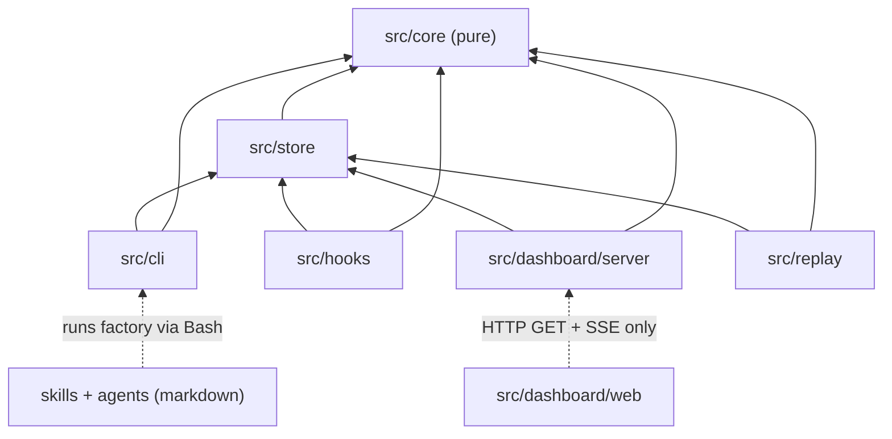
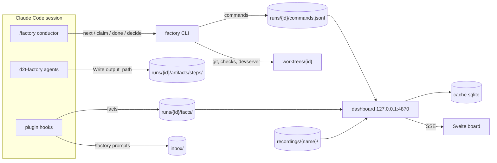
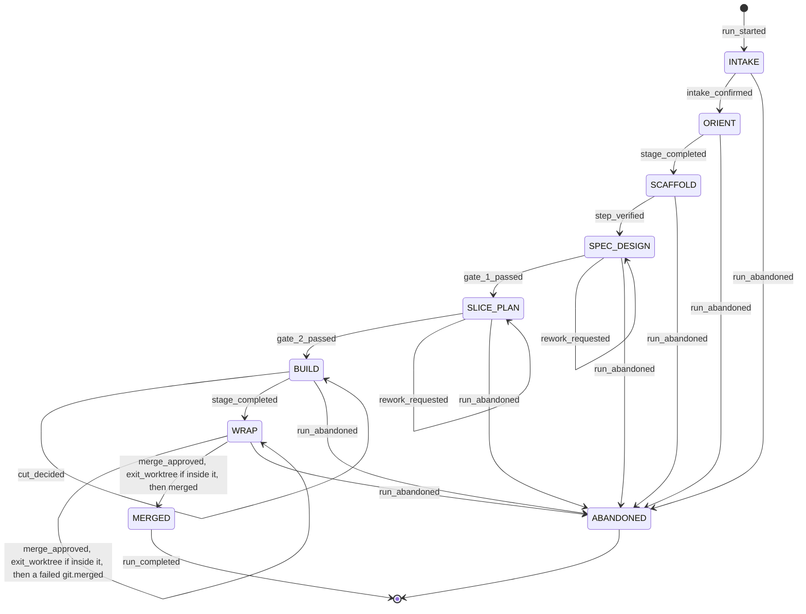
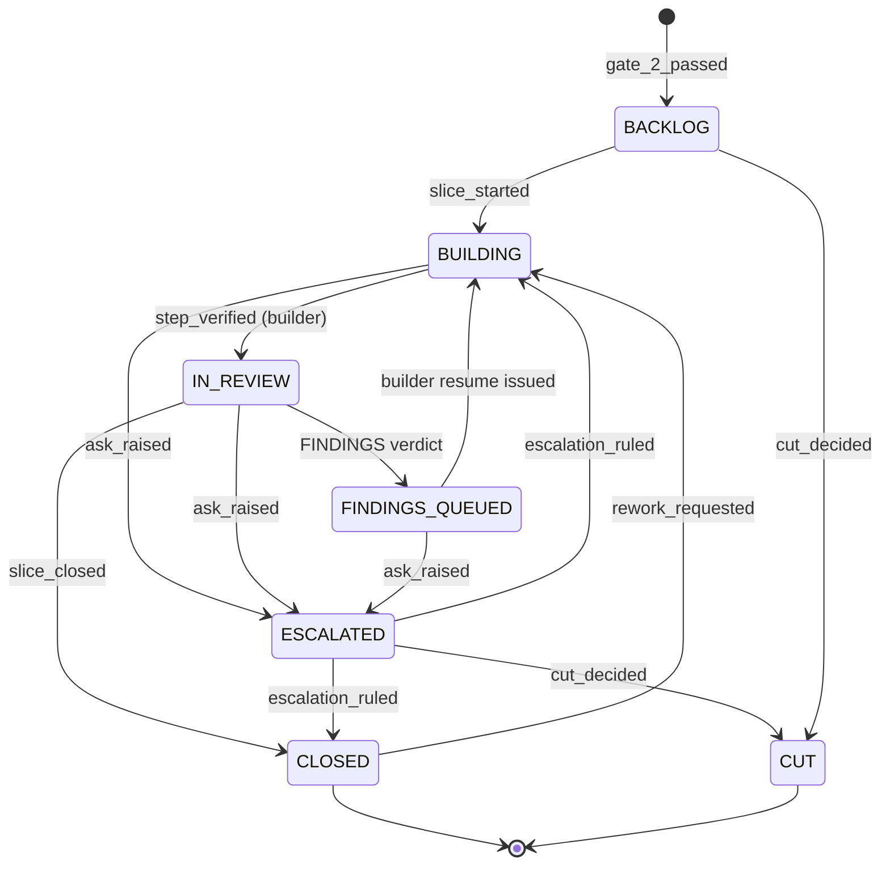

# Architecture Spine — d2t-factory

## Design Paradigm

**Event sourcing + CQRS-lite, with the LLM as an untrusted client.**

- **Record.** Append-only JSONL streams are the only source of truth.
  - *Commands* are written only by the CLI, and they alone decide state.
  - *Facts* are written only by hooks, and they are evidence.
- **Meaning.** One pure reducer in `core` folds the command stream into run state. One pure verifier joins facts to claims.
- **Read models.** The CLI's view, the SQLite cache, the dashboard and replay are all projections of that one fold, and each can be rebuilt.
- **Untrusted clients.** The conductor skill and the agents can only *request* changes, through the `factory` CLI. The CLI is the **driver**: it decides *what* happens next, and the conductor decides *how* a step gets done.

| Layer | Directory | Role |
| --- | --- | --- |
| Functional core | `src/core/` | Event schema, reducer, slice machine, verifier, decision grammar, artifact schemas, roster, cards, output parser, redaction, constants, upcasters. Pure; no I/O. |
| Store | `src/store/` | `paths.ts`, `jsonl.ts`, locks and atomic claims, `loadRun` |
| Adapters (imperative shell) | `src/cli/`, `src/hooks/`, `src/dashboard/server/`, `src/replay/` | Turn the outside world into events, or project events outward |
| UI | `src/dashboard/web/` | Svelte app; uses only HTTP GET and SSE |
| Prompts | `skills/`, `agents/` | Markdown; reach the system only by running `factory …` |

## Invariants & Rules



### AD-1 — One reducer, one record

- **Binds:** CAP-1, CAP-14, CAP-15, CAP-16
- **Prevents:** Two sources of truth, and the board, the CLI and replay deriving state differently.
- **Rule:**
  - Run state is the fold of `commands.jsonl` alone, through `core`. The fold is total and never rejects; the CLI validates before it appends.
  - Facts feed only the claim overlay (AD-7) and the CLI's pre-append checks.
  - Every command that relies on a fact either embeds it verbatim (redacted) or names it by `id`. Replay therefore never re-matches.
  - The CLI, the dashboard server and replay call the same `loadRun` and reducer.
  - `cache.sqlite` is a cache. Deleting it must reproduce the same board, with the live-only overlays of AD-21 excluded.

### AD-2 — Dependency direction

- **Binds:** all
- **Prevents:** Logic leaking into adapters, and anything writing state behind the CLI's back.
- **Rule:**
  - Imports follow the diagram. `core` imports nothing and does no I/O. Adapters never import one another. `src/dashboard/web` imports nothing from `src/`.
  - **What skills and agents may touch under `~/.factory/`:**
    - **Read:** only their `brief_path` and the inputs it lists.
    - **Write:** only their step's artifacts directory, `artifacts/steps/<step_id>/`.
    - **Everything else:** they go through `factory`.
  - Product code is written only inside the run's worktree.
  - Only the conductor session invokes `factory`. Agents never call it.
### AD-3 — The CLI drives the pipeline

- **Binds:** CAP-1, CAP-2, CAP-5, CAP-7, CAP-8, CAP-10, CAP-11
- **Prevents:** The conductor improvising order, double-spawning agents, or busy-looping.
- **Rule:**
  - **The loop.** Every `/factory` turn starts with `factory decide` (AD-6). Then: `factory next` → `factory claim` each issued step → do it → `factory done`. The conductor never runs a step that `next` didn't return, and never resumes or retries on its own.
  - **What `next` returns.** `{steps:[…], in_flight:[step_id…], wait?:{retry_after_ms: number}, done?:true}`.
    - Each step is `{step_id, kind, agent?, agent_id?, brief_path?, output_path?, card?}`.
    - `kind` is one of `spawn`, `resume` (`agent_id` required), `ask_human`, `run_check` or `enter_worktree`.
    - `wait` and `done` are responses. They are never issued or claimed.
    - `agent` is the full namespaced type, passed verbatim as `subagent_type`.
  - **Limit.** At most one open step per agent role per run.
  - **On `wait`.** The conductor runs `factory next --wait <ms>`, which blocks unlocked until something changes.
  - **Conductor latitude.** The *content* of a step: the INTAKE conversation, the rework translation and the gate summary, submitted with `--note`. Narration is at most one line per step.
  - **Name clash.** `factory next` is an internal CLI verb, not the `/factory next` slash command (a non-goal).
### AD-4 — Writers and log layout

- **Binds:** CAP-12, CAP-14
- **Prevents:** Concurrent appends, and races between async hooks deciding state.
- **Rule:**
  - `runs/<run-id>/commands.jsonl` is written only by the CLI, under the AD-29 lock.
  - Hooks write only to these places:
    - `runs/<run-id>/facts/<session_id>-<agent_id|main>.jsonl`;
    - the inbox (AD-26);
    - `plugin-env.json` (`SessionStart` only, AD-19);
    - `hook-errors.log`.
  - All JSONL reads and writes go through `src/store/jsonl.ts` (AD-28).
  - Facts never change state. They are pinned into commands by `id`.
### AD-5 — Event envelope and typed kinds

- **Binds:** CAP-14, CAP-15, CAP-16; the UX Decision drawer `event` row
- **Prevents:** Writers inventing field names, payloads or stage spellings.
- **Rule:**
  - **Envelope.** Every line is `{v:1, id:ULID, ts:ISO-8601 UTC ms, run, session?, kind, actor, corr, data}`.
    - `session` is required on facts and on decision commands.
    - `actor` is `human` for decisions, `cli`, `conductor` for claims, or `d2t-factory:<role>`.
    - `corr` is set on commands only: the `step_id` for step-scoped kinds, otherwise the `id` of the causing command. Facts carry `corr: null`.
  - `src/core/events.ts` exports a discriminated union with a typed `data` per kind, plus a validator. Every writer validates before it appends, and readers ignore unknown `data` fields.
  - **Stage enum:** `INTAKE | RECON | FRAME | SCAFFOLD | SPEC | DESIGN | SLICE_PLAN | BUILD | WRAP`.
  - **Command kinds:** `run_started`, `session_bound`, `stage_started`, `stage_completed`, `step_issued`, `step_claimed`, `step_reported`, `step_verified`, `step_reissued`, `check_ran`, `ask_raised`, `slice_started`, `slice_closed`, `merged`, `run_completed`.
  - **Decision kinds** (also commands; `actor: human`): `intake_confirmed`, `gate_1_passed`, `gate_2_passed`, `rework_requested`, `escalation_ruled`, `design_choice_made`, `cut_decided`, `stage_rerun_requested`, `merge_approved`, `run_abandoned`.
  - **Fact kinds:** `human_prompt`, `prompt_text`, `session_started`, `session_ended`, `subagent_started`, `subagent_stopped`, `tool_succeeded`, `tool_failed`, `output_written`.
  - `check_ran.data` = `{check: contract.test|contract.health|git.baseline|git.worktree_clean|git.deps|git.merged|spec.lint|plan.lint|devserver, command?, exit_code, duration_ms, sha?, dirty?, basis_seq, error?}`. `error` (additive, dry run 2): a failed `git.merged` keeps git's redacted error text.
  - A **claim** is `step_reported` with `actor: conductor`.

### AD-6 — Human decisions come only from typed `/factory` commands

- **Binds:** CAP-1, CAP-2, CAP-5, CAP-7, CAP-10, CAP-11, CAP-13, CAP-15
- **Prevents:** Approvals asserted by the LLM, re-typed arguments, and a wedged prompt queue.
- **Rule:**
  - **The skill.** `skills/factory/SKILL.md` sets `name: factory` and `disable-model-invocation: true`. `/d2t-factory:factory` is an equivalent spelling.
  - **The facts.**
    - The `UserPromptExpansion` hook (matcher `^d2t-factory:factory$`) writes `human_prompt{prompt_id, command_name, command_args}`.
    - The `UserPromptSubmit` hook writes `prompt_text{prompt_id, prompt}`, the verbatim text, for prompts starting `/factory` or `/d2t-factory:factory`.
    - No tool hook ever emits either fact, so a model-initiated Skill call produces none.
  - **`factory decide`.** It is the only consumer of prompt facts, and it takes no decision arguments.
    - It consumes the calling session's newest unconsumed `human_prompt` (AD-26) and marks older ones superseded.
    - `src/core/decision.ts` parses `command_args` with the Conventions grammar, and the result is one of three outcomes:

      | Parse result | What happens |
      | --- | --- |
      | A legal decision | The CLI appends the decision command |
      | A decision that is illegal in the current state | The prompt is consumed and the CLI returns `ILLEGAL_TRANSITION`; the human retypes |
      | A non-decision (task text, `resume`, bare) | `decide` returns it, and `start` / `resume` act only on what `decide` returned |

  - **Transcript cross-check.** `decide` accepts a prompt only if the session's own transcript holds a human turn for that exact prompt. A mismatch shows as `UNVERIFIED · transcript mismatch` and never passes a decision.
    - **Which transcript.** The CLI finds the transcript itself, never from a fact: `~/.claude/projects/*/<session_id>.jsonl`, with exactly one match whose realpath lies under `~/.claude/projects/`. `transcript_path` in a fact is display-only.
    - **Which turn.** The turn's `promptId` must equal the fact's `prompt_id`, with `sessionId` equal to the session, `turnOrigin: "human"`, and text equal to `prompt_text`. Any other user turn, even one with the same text, doesn't count, so an earlier genuine approval can't be replayed.
    - **Why (spike 02).** A forged inbox line pointing at a fake transcript returned VERIFIED, and so did a forged line replaying an earlier genuine turn.
  - **The record.** Decision commands carry `actor: human`, `data.prompt_fact_id`, and the embedded `human_prompt` and `prompt_text`.
### AD-7 — Verification table and attribution

- **Binds:** CAP-14, CAP-15
- **Prevents:** Each component inventing its own join or its own definition of "verified".
- **Rule:** `src/core/verify.ts` is the only home of both.
  - **Attribution.** Every `output_path` is unique per step and lies in `artifacts/steps/<step_id>/`.
    - `output_written` → step, by realpath match.
    - That fact's `agent_id` → the step's agent.
    - A `subagent_*` fact → the latest step claimed for its `agent_id` at or before the fact's `ts`. Resumes reuse the `agent_id`.
    - `agent_type` is only a consistency check.
  - **The table:**

    | Claim | Verified by |
    | --- | --- |
    | Agent step done | Attributed `subagent_stopped` **and** `output_written` whose file parses (AD-11) |
    | Worktree entered | The next CLI call's cwd is inside the run's worktree |
    | Tests / health / SCAFFOLD / slice close | `check_ran`, run by the CLI (AD-8) |
    | Intake, rework, ruling, design choice, cut, rerun, abandon | Consumed `human_prompt` (AD-6) |
    | Gate 1 | `human_prompt` + `check_ran spec.lint` + verified `design` step when required (AD-27) |
    | Gate 2 | `human_prompt` + `check_ran plan.lint` |
    | Merge approved | `human_prompt` + the merge evidence (AD-8) |
    | Merged | `merge_approved` + `check_ran git.merged` (exit 0), run by `next` after the conductor left the worktree |

  - **`step_verified`.** When `next` or `done` observes the evidence, the CLI appends `step_verified{step_id, evidence:[fact ids]}`. Only `step_verified` unblocks dependent steps.
  - **Supporting facts.** A `tool_succeeded` from a test the builder ran itself is shown as supporting, never as verified.
  - **Overlay states** (the board's CLAIMED / VERIFIED / UNVERIFIED) apply only to `reported` steps:
    - **reported:** evidence is pending. `waiting_on` says on what: `human` (an `ask_human` step, or the subject of an open ask), `checks` (a scaffolder that reported `DONE` with no failure and no open ask, until it is verified: it follows the SCAFFOLD schedule, so the gaps before each contract check is issued count too), or null (only hook facts). Only a null wait has an `overdue_at`.
    - **verified.**
    - **unverified:** `waiting_on` is null, and `CLAIM_OVERDUE_MS` has passed since `step_reported`. It means only "claimed, and the hooks never confirmed it".
    - The CLI's overdue reissue (AD-24) and the board both use this one overlay (dry run 1, finding 5).
### AD-8 — Evidence checks and all git run in the CLI

- **Binds:** CAP-4, CAP-5, CAP-7, CAP-8, CAP-12, CAP-13
- **Prevents:** A builder's own test command line counting as proof, and the conductor running git that Claude Code's worktree isolation blocks.
- **Rule:**
  - **Steps vs inline probes.**
    - Test, health and lint checks run only as `run_check` steps, via `factory check <step_id>` with `timeout_ms`. The conductor runs them as background Bash.
    - `git.*` and `devserver` probes run inline in the CLI verb that needs them, unlocked, and append with `basis_seq`.
  - **What gets run where:**
    - At slice close: test.
    - At SCAFFOLD done and WRAP: health and test.
    - At Gate 1: `spec.lint`.
    - At Gate 2: `plan.lint`.
  - **Brownfield.**
    - `run_started` snapshots the main checkout's `git status --porcelain=v2` as `git.baseline`. The main checkout must equal it at the end of ORIENT, at SCAFFOLD done and before merge.
    - At SCAFFOLD done, the worktree has no tracked changes.
    - At slice close, `git.deps` diffs manifests and lockfiles. Any change raises a `New dependency:` escalation.
    - **SCAFFOLD repair.** A failed SCAFFOLD check resumes the scaffolder once (`SCAFFOLD_REPAIR_ROUNDS`) with a repair brief (`review-policy.md` SCAFFOLD repair) before `scaffold_failure` is raised; the card lists both rounds. An `ESCALATE` from the scaffolder raises it at once. `paths.ts` adds `runs/<run-id>/cache/`, exported to every contract command as `FACTORY_CACHE_DIR`.
  - **Git.** Every git operation lives in the CLI: baseline, worktree add, the per-step commits (AD-30), merge, and PR via `gh`.
  - **Merge.** `decide` records `merge_approved` and does not merge. While that approval is pending (no `git.merged` after the last `merge_approved`), `next` integrates nothing and raises no merge card; a conductor inside the worktree is issued `exit_worktree` first, because the sandbox lets a command write only under the session's cwd. Once the conductor is outside the worktree and nothing is open, `next` (holder only, unlocked) merges the approved commit of the last `merge_approved`. An approved commit already in the main checkout's HEAD counts as merged (a round whose merge was not appended). Otherwise it re-checks that the main checkout is on the approved branch, that its HEAD is still the target commit the approved merge card was pinned to (a target that moved since was never integrated or tested), and that it equals its baseline; then it runs `git merge --no-ff <approved sha>`. It appends `check_ran git.merged` (`command` only when git merge ran) and, on success, `merged`; then `run_completed` follows. A failure (a refused re-check, or git's error, conflicts included, redacted into `check_ran.data.error`) is aborted and leaves the run in WRAP: the merge card comes back with the error at the end of its reason (after a fresh integration and fresh checks when the target moved), and `/factory merge` retries. Only a successful merge spends the approval; nothing re-merges without a fresh `/factory merge`. Conflicts with the target are resolved before the card, on the run branch: WRAP's integration reports them on a card without the merge.
### AD-9 — Identity: repo, run, branch

- **Binds:** CAP-1, CAP-3, CAP-12, CAP-14
- **Prevents:** Colliding IDs, worktrees of one repo hashing differently, and greenfield runs having no identity.
- **Rule:**
  - **`repo-hash`** = the first 12 hex characters of `sha256(realpath(git rev-parse --path-format=absolute --git-common-dir))`. The path is never joined onto cwd: in a linked worktree git already returns it absolute (spike 0-1 review E3).
  - **Greenfield.** `factory start` in a directory that isn't a git repo first runs `git init` and an empty commit `factory: init`. Project files are created only in the worktree.
  - **`run-id`** = `<slug>-<4 lowercase base32 chars>`, claimed by an atomic `mkdir runs/<run-id>`.
  - **Branch** = `factory/<run-id>`. `run_started.data.base_sha` pins the base commit.
  - **Run from cwd** = parse `factory-<run-id>` or `<run-id>` from the worktree directory name, in either placement (AD-15).

### AD-10 — Factory artifacts never live in the worktree

- **Binds:** CAP-2 to CAP-8, CAP-13; the constraint that nothing lands in the target
- **Prevents:** Specs and verdicts being merged into the target, rework overwriting approved content, and three authors for briefs.
- **Rule:**
  - **Layout.** `src/store/paths.ts` assigns `runs/<run-id>/artifacts/steps/<step_id>/` for each step, holding `brief.md`, `out.md` and any screenshots.
    - There are no fixed artifact names. "Current spec / context / plan" is the output of the latest verified step of that stage, which is a reducer query.
    - INTAKE ends with an `intake` step whose `out.md` the conductor writes.
  - **Briefs.** The CLI is the only writer of `brief.md`. Each brief lists its input paths explicitly.
  - **Pinned approvals.** `intake_confirmed`, the gates and the merge record the `sha256` of every approved artifact. A later mismatch is `MISSING_EVIDENCE`.
  - **RECON cache.** After `step_verified`, the CLI publishes a RECON output to `<repo-hash>/recon/<base_sha>.md` via temp file plus `rename`, only if absent.
    - On a cache hit, `next` skips RECON. `stage_completed.data` embeds the parsed context projection and the file's sha256, and reducer queries treat that as the verified RECON output.
### AD-11 — Agent output protocol

- **Binds:** CAP-6, CAP-8, CAP-9, CAP-10
- **Prevents:** Each agent inventing its own verdict vocabulary or finding shape.
- **Rule:** Each step writes `out.md` at its `output_path`, using `Write`. Screenshots go in the same step directory.
  - **Line 1.**
    - Reviewers: `VERDICT: APPROVE|FINDINGS|ESCALATE`.
    - All other agents: `STATUS: DONE|ESCALATE`.
    - These are the only two forms.
  - **Line 2 after `ESCALATE`:** `<Label>: <one line>`. The label is one of `Scope change | Spec ambiguity | Irreversible action | New dependency | Non-convergence | Over time box | Taste disagreement | Scaffold failed`.
  - **Findings.** Each finding is a fenced ` ```finding ` block containing `category: Bug|Spec miss|Security|Breakage`, `location: <path>:<line> | <url>#<state>` and `failure_scenario:`, one per line, in that order.
    - `reviewer-ux`, `reviewer-a11y` and `reviewer-ui` must also give `observed: <url> <state> [<screenshot path>]`.
  - **Designer question.** The designer's one question is a fenced ` ```question ` block with options `a` and `b` and a default.
  - **Parse failure.** At `done`, the CLI parses with `src/core/output.ts`. On a parse error it returns `MISSING_EVIDENCE` and appends `step_reissued` as a `resume` of the same `agent_id`, with the parser error in the new brief.
### AD-12 — Stop is allowed only when the run awaits a human, background work or nothing

- **Binds:** CAP-1, CAP-14
- **Prevents:** The Stop hook trapping INTAKE, gates or escalations, or forcing busy-polling during parallel work.
- **Rule:**
  - The synchronous Stop hook calls `core`'s `mayStop(state, background_tasks)`. It is true iff one of these holds:
    - every open step is either `ask_human`, the parked subject of an open escalation, a reissued `exit_worktree` (attempt > 1: `ExitWorktree` did not move the session, so the human goes on from the main checkout, AD-15), or claimed and running in the background (a `d2t-factory:*` entry or a background shell in `background_tasks`);
    - the run is terminal.
  - **Human rejection.** The hook also allows the stop when the session's own transcript (located as in AD-6) holds, after the turn's last human prompt, a tool use the human rejected, matched on Claude Code's structured record (fixture pinned by story 6-1), never on a substring. It appends `stop_yielded{reason, tool_use_id}`. A user interrupt never reaches Stop: Claude Code skips the hook then.
  - **Block cap.** Otherwise the hook blocks, whatever `stop_hook_active` says, up to `STOP_BLOCK_MAX` consecutive blocks for the holder session (counter in `sessions/<session>.stop`; reset by a `tool_*` fact from that session after the last block, or by a human prompt). The next stop then passes and appends `stop_forced{blocks}`. Claude Code's own cap (8 continuations, also reset by a tool call) is never reached.
  - Both facts are a dashboard-only lane notice (`PAUSED`); the `SessionStart` nudge resumes the run.
  - INTAKE turns, the designer's question and every escalation are `ask_human` steps.
  - Unbound sessions, and sessions that aren't the run's current holder, always pass.
  - **Always-on nudge.** On `startup`, `clear`, `resume` and `compact`, the `SessionStart` hook of a bound session injects the bound run, its stage and "run `factory next`" as `additionalContext`. This covers turns that end without Stop firing, such as `StopFailure` or `/clear`.
  - **What the nudge can do (spike 06).** Claude Code never starts a turn by itself after `/clear`, and `initialUserMessage` doesn't start one in an interactive session. So the nudge takes effect on the first turn a human starts, and that turn resumes the run without being told about it.
### AD-13 — Hooks are invisible outside the factory

- **Binds:** the constraint "never alter non-factory sessions"; CAP-14
- **Prevents:** A user-level plugin breaking or slowing other sessions.
- **Rule:**
  - **Event types.** The plugin registers no `WorktreeCreate` or `WorktreeRemove` hook.
    - **Synchronous:** `UserPromptSubmit`, `UserPromptExpansion`, `Stop`, `SessionStart`, and `PreToolUse` (the guard, AD-31).
    - **`async: true`:** `SubagentStart`, `SubagentStop`, `PostToolUse`, `PostToolUseFailure`, `SessionEnd`.
  - **Invocation.** Every hook is exec-form: `${CLAUDE_PLUGIN_ROOT}/bin/factory` with args `["hook", "<event>"]`.
  - **Non-factory sessions.** Every hook resolves `session_id` → run first. For unbound sessions it exits 0 with no output. The prompt hooks are the exception: they always write `/factory` prompts to the inbox.
  - **Failures.** Exceptions exit 0 and append to `~/.factory/hook-errors.log`. No hook ever exits 2, except the Stop block (AD-12) and the guard's deny (AD-31).
  - **Speed.** Fact hooks do a single append and never call git.

### AD-14 — Facts are minimal; redaction is single-sourced

- **Binds:** CAP-14, CAP-16
- **Prevents:** Secrets spreading, and divergent redaction.
- **Rule:**
  - **What a fact keeps.** A whitelisted projection only:
    - `session_id`, `agent_id`, `agent_type`, `tool_name`, `tool_use_id`, `duration_ms`;
    - the command line;
    - the file realpath, plus the output's `first_line` (≤ 200 chars);
    - `transcript_path` and `agent_transcript_path`;
    - for prompts, `prompt_id`, `command_name`, `command_args` and `prompt`.
  - **Exit codes.** `tool_succeeded` implies exit 0. `tool_failed.exit_code` is parsed from `/^Exit code (\d+)/` in the `PostToolUseFailure` `error`, or null.
  - **Redaction.** `src/core/redact.ts` runs at write time in every writer, and again at `factory record`; it is idempotent. Its inputs:
    - secret patterns;
    - the values in `runs/<run-id>/redact.json` (mode 0600, never recorded), which the CLI writes when it copies gitignored files into the worktree.

### AD-15 — The CLI creates worktrees; the conductor enters them by path

- **Binds:** CAP-12
- **Prevents:** Worktrees inside the target repo, and a global hook that hijacks every session's worktrees.
- **Rule:**
  - **Creating it.** The CLI runs `git worktree add <repo>/.claude/worktrees/factory-<run-id> -b factory/<run-id> <base_sha>`. It ensures `.claude/worktrees/` is listed in the untracked `.git/info/exclude`, and copies the gitignored files the run contract names. Only `paths.ts` resolves the location.
  - **Entering it.** The `enter_worktree` step is issued only when the calling CLI's `realpath(cwd)` is outside the run's worktree. The conductor then calls `EnterWorktree` with `path`. The session's cwd survives `/clear`, so this happens once per session.
  - **Leaving it.** After `merge_approved`, before the merge (AD-8), `exit_worktree` is issued while the calling CLI's cwd is inside the worktree; the conductor calls `ExitWorktree` (keep). The worktree is kept after `merged`: the sandbox keeps an entered worktree's `.git` file and `commondir` read-only for that session (and `commondir` for later sessions), so the CLI never removes it. If `ExitWorktree` is a no-op (e.g. after `/clear`), `done` from inside refuses and reissues the step, and its message tells the human to start `claude` in the main checkout and type `/factory resume <run_id>`; that session's cwd verifies the step and the merge follows. The reissued step lets the turn end (AD-12). Runs merged by an older CLI got `exit_worktree` after `merged`; that path stays.
  - **Why not `~/.factory` (spike 01).** `EnterWorktree` on a path outside `.claude/worktrees/` prompts every time, whatever the allow rules say, and can't enter a second such worktree from inside one. The in-repo placement entered with zero prompts, both fresh and after `/clear`, and left `git status` clean.
  - **Factory artifacts still live under `~/.factory` (AD-10).** Only the git worktree is in the repo.
  - **Shared mutable service.** If the run contract lists one, the run claims `<repo-hash>/exclusive/` by `mkdir` at SCAFFOLD. `factory start` refuses with `REFUSED_EXCLUSIVE` while the claim is held by a run that isn't terminal.
### AD-16 — The dashboard is a read-only singleton projection

- **Binds:** CAP-15, CAP-16
- **Prevents:** Competing servers, any browser write path, and thresholds duplicated in the browser.
- **Rule:**
  - **Process.**
    - There is one process per machine, on `127.0.0.1:<dashboard_port>` (default 4870).
    - The port bind is the lock. `dashboard.pid` = `{pid, plugin_version, root}` is written after the bind.
    - `factory start` and `resume` start it detached, and restart it on a version mismatch.
    - A foreign `EADDRINUSE` is reported, never assumed to be ours.
    - Requests whose `Host` isn't `127.0.0.1:<port>` or `localhost:<port>` are rejected.
  - **Data.**
    - It is the only opener of `cache.sqlite`.
    - It tails `~/.factory/*/runs/*/{commands.jsonl,facts/*.jsonl}` with `fs.watch` (recursive), plus a 2 s poll, tracking byte offsets.
  - **Routes** (GET only):
    - `/api/board` returns `{cursor, projection}`.
    - `/api/stream?since=` is SSE and honors `Last-Event-ID`.
    - `/api/recordings/<name>` returns 404 `RECORDING_NOT_FOUND` when missing.
    - The SPA is served at `/` and `/replay/<name>`.
  - **Deadlines.** The projection carries absolute deadlines (`overdue_at`, `cut_at`, `ends_at`, `timebox_ends_at`, `signal_lost_at`). The browser only compares them with its clock.

### AD-17 — Time affects flags; transitions are commands

- **Binds:** CAP-8, CAP-10, CAP-11, CAP-16
- **Prevents:** Live, rebuild and replay disagreeing, and late cuts.
- **Rule:**
  - **`now` sets flags only:** `overdue`, `at_risk`, `timebox_exceeded`, `signal_lost`.
  - **Time-driven transitions** exist only as commands the CLI appended: `ask_raised` for a cut, or for an `Over time box` escalation.
  - **The clock** runs from `run_started.ts`, or from the intake's `started` if that is earlier. It never pauses. With `limit_min` it is the budget clock (`cut_at`, `ends_at`); without it the projection carries only `clock_start`, the board shows elapsed time, and no cut is ever raised.
  - **The slice time box** counts wall time since `slice_started`, minus time with an open escalation on that slice.
  - **Waking the conductor.** On a `wait`, the conductor runs `factory next --wait <ms>` as a background Bash. `retry_after_ms` is never later than the next deadline: a cut, a time box or a claim overdue. When the shell exits, Claude Code wakes the conductor. There is no monitor.
  - **Timestamps.** A fact's `ts` is the hook's wall clock. Facts are ordered by `(ts, id)`, and only for display.

### AD-18 — Recordings are event trees; replay folds them

- **Binds:** CAP-16
- **Prevents:** A separate replay engine, secrets in recordings, and recordings from increments 1–3 being unreadable in increment 4.
- **Rule:**
  - **Making one.** `factory record <name> [--runs id,…]` runs at any time; WRAP's default is the current run. It writes `recordings/<name>/` containing:
    - `manifest.json {v, name, recorded_at, plugin_version, runs[]}`;
    - `runs/<repo-hash>/<run-id>/…`, the redacted JSONL tree;
    - `transcripts/<session>[-<agent>].jsonl`, redacted line by line.
  - **Serving one.** `/api/recordings/<name>` returns the ordered events, each with its post-event projection and deadlines, produced by the AD-1 reducer. The browser plays, pauses and seeks on its own clock.
  - Replay never reads the live `runs/`.
  - Dry runs and recordings are made only in interactive sessions, never with `claude -p`, because `-p` teardown drops async facts.

### AD-19 — Runtime dependency line and plugin environment

- **Binds:** all
- **Prevents:** The truth layer failing without `node_modules`, Claude Code auto-installing at the plugin root, and the CLI guessing plugin paths.
- **Rule:**
  - **No runtime dependencies.** `src/core`, `src/store`, `src/cli`, `src/hooks`, `src/replay` and `src/dashboard/server` use only Node built-ins, run with native type stripping.
  - **Dashboard build.**
    - Only `src/dashboard/web` has npm dependencies. Its `package.json` and lockfile live there, never at the plugin root.
    - `dashboard/dist/` is committed.
    - If it is missing, the fallback build writes to the plugin data directory.
  - **Paths and environment.**
    - The CLI finds the plugin root from the realpath of `bin/factory`.
    - It reads the data directory and `userConfig` from `~/.factory/plugin-env.json`, which every `SessionStart` hook rewrites.
  - **Node.**
    - `bin/factory` is a POSIX `sh` shim. It execs `~/.factory/node` (recorded by `factory setup`), or `node` on PATH when that file is absent.
    - It refuses with `NODE_VERSION` below the floor in Stack.
### AD-20 — Machine resources are claimed atomically

- **Binds:** CAP-12
- **Prevents:** Shared ports, orphaned processes, and leaked claims.
- **Rule:**
  - **Port.** The CLI claims the dev-server port by `mkdir ~/.factory/ports/<n>` (from `PORT_RANGE`) *before* SCAFFOLD, and passes it in the brief.
  - **Dev server.** The CLI alone owns it.
    - `factory devserver up` spawns the run contract's `start` detached, with `PORT=<n>`, and keeps its pid and log in `runs/<run-id>/devserver.*`.
    - `next` health-checks it before any running-app step and restarts it if needed.
    - It is killed before the port is released.
  - **Release.** Ports and `exclusive/` are released only when the fold is terminal (`run_completed` or `run_abandoned`).
  - Agents never start or kill servers.

### AD-21 — Tunable constants live in one module

- **Binds:** CAP-8, CAP-11, CAP-15
- **Prevents:** Thresholds that differ between the CLI and the dashboard.
- **Rule:**
  - `src/core/config.ts` alone defines:

    | Constant | Value |
    | --- | --- |
    | `HEARTBEAT_INTERVAL_MS` (a heartbeat is any command or fact for the run) | 60 000 |
    | `SIGNAL_LOST_MISSED` | 3 |
    | `CLAIM_OVERDUE_MS` | 30 000 |
    | `CUT_LEAD_MS` | 40 min |
    | `SLICE_TIMEBOX_DEFAULT_MS` | 30 min |
    | `MAX_RETRIGGER_ROUNDS` | 2 |
    | `PORT_RANGE` | 5100–5199 |
    | `LOCK_WAIT_MS` | 10 000 |
    | `SPEC_MAX_LINES` | 40 |
    | `STOP_BLOCK_MAX` | 3 |
    | `SCAFFOLD_REPAIR_ROUNDS` | 1 |
    | `ARTIFACT_EMBED_MAX` | 64 KiB |

  - **Non-convergence:** the slice's round count reaches `MAX_RETRIGGER_ROUNDS` with a `FINDINGS` verdict still outstanding. A round is one builder `resume` issued in response to `FINDINGS`.
  - **SIGNAL LOST** is a live-only dashboard overlay that applies only in working states. It fires when no event has arrived for `SIGNAL_LOST_MISSED × HEARTBEAT_INTERVAL_MS` **and** no session bound to the run appears in `claude agents --json` (an idle session counts as live). Replay derives it from event gaps alone. The CLI never reads it.

### AD-22 — Browser driver selection

- **Binds:** CAP-9
- **Prevents:** Reviewers choosing different tools or sharing a browser session.
- **Rule:**
  - Reviewers use the run contract's `e2e` tooling when it names one.
  - Otherwise they use pinned `agent-browser` via `npx`, with `--session <run-id>-<role>`, against the run's single dev server.
  - `factory setup` runs `agent-browser install` once.
  - **Open (spike 04).** Under the Bash sandbox, `npx agent-browser` fails: npm gets EPERM on `~/.npm`, and the daemon dies at startup even with those directories writable. Isolation itself held with the sandbox off. Before increment 3, choose between the Playwright MCP fallback (after its own isolation check) and running reviewer browser commands outside the sandbox.

### AD-23 — Everything the board shows lives in event data

- **Binds:** CAP-7, CAP-8, CAP-15, CAP-16
- **Prevents:** A dashboard or replay that can't see slices, rosters, checks or reasons stored only in artifacts.
- **Rule:**
  - At `done` and `check`, the CLI parses outputs with `core` and embeds their redacted projections in command `data`. This covers:
    - the slice list, with roster and dependencies;
    - gate check rows, and the count of Assumptions items;
    - escalations: `E<n>`, label, line, slice/stage;
    - findings;
    - verdicts;
    - merge resolutions;
    - the pinned artifacts: at `step_verified` of an intake, spec-writer, designer or slicer step, the redacted body (≤ `ARTIFACT_EMBED_MAX`, else truncated and marked), its sha256 and path.
  - The dashboard never reads `artifacts/`.

### AD-24 — Step lifecycle

- **Binds:** CAP-1, CAP-8
- **Prevents:** Respawning in-flight steps, double builders in one worktree, and unstable step IDs.
- **Rule:**
  - **Issuing.** `factory next` is mutating. Under the lock it appends `step_issued` for each newly due step, and `step_id` is that event's `id`.
  - **States:** `issued → claimed → reported → verified | reissued`.
  - **Claiming.** `factory claim <step_id> [--agent-id]` appends `step_claimed` (with `session`), or fails with `CLAIM_TAKEN`.
  - **Time limits.**
    - `claimed` steps never time out. The slice time box covers long work.
    - A `reported` step whose evidence is still missing `CLAIM_OVERDUE_MS` after `step_reported`, and whose `waiting_on` is null (AD-7), is reissued once, then raises an `ask_human`.
  - **Orphans.** A claim held by a superseded session is orphaned. It is reissued (`step_reissued{old,new}`, a new `step_id` and `output_path`, `attempt+1`) only once one of these holds:
    - its attributed `subagent_stopped` has arrived;
    - no fact has come from its `agent_id` for `SIGNAL_LOST_MISSED × HEARTBEAT_INTERVAL_MS`.
  - **Resume.** `next` issues `resume` only for an `agent_id` spawned under the current `session_bound`. Otherwise it issues `spawn` with a rework brief.
### AD-25 — Session binding has one current holder

- **Binds:** CAP-1, CAP-14
- **Prevents:** Two terminals driving one run, stale bindings after `/clear`, and hooks that can't find their run.
- **Rule:**
  - **Where the session ID comes from.** The conductor skill passes `--session ${CLAUDE_SESSION_ID}` (a documented skill substitution) on every `factory` call. If `CLAUDE_CODE_SESSION_ID` is present and differs, the CLI fails with `BAD_ARGS`.
  - **Binding.** `session_bound{session, supersedes?}` makes that session the run's only conductor.
    - At the same time, the CLI atomically writes `~/.factory/sessions/<session>.json {repo_hash, run_id}` and deletes the superseded one.
    - Hooks resolve the run only through this file. No hook writes it, with one exception.
    - **Exception: rebinding after `/clear` (spike 06, option A).** `/clear` gives the session a new `session_id`, and nothing in the new payload names the old one.
      - At binding, the CLI also records the Claude Code process identity in the session file: the hook's parent pid plus that process's start time.
      - On `SessionStart` with source `clear` from an unbound session, the hook looks for a session file whose recorded pid and start time match its own parent. If it finds one, it writes the new session's file, deletes the old one, and appends `session_bound{supersedes}` to its facts.
      - This depends on exec-form hooks, where the parent is the Claude process. `--resume`, `--continue` or a crash give a new process, so those go through the normal `resume` path.
  - **When the holder counts as live.** Its session ID appears in `claude agents --json` (an idle session counts), which the CLI reads directly.
  - **Bare `/factory`.** Resolution follows the spec: the worktree's run, else the single live run, else a list. It refuses with `CLAIM_TAKEN` if the holder is live.
  - **Typed `/factory resume`.** This is a human takeover and always rebinds.
  - **Other sessions.** A mutating call from a session that isn't the holder fails with `NOT_HOLDER`. `start`, `resume` and `decide` are exempt.
### AD-26 — One inbox, one consumption ledger

- **Binds:** CAP-1, CAP-14
- **Prevents:** Prompt facts lost before binding, consumed twice, or lost on a failed append.
- **Rule:**
  - **Where prompt facts go.** Every `human_prompt` and `prompt_text` fact goes to `~/.factory/inbox/<session_id>.jsonl`, whether or not the session is bound. Prompt facts never go into the run fact files.
  - **Consuming.** Under the run lock, the CLI does three things in order:
    1. validates;
    2. runs `mkdir ~/.factory/inbox/consumed/<prompt_id>` (if it already exists, the result is `CLAIM_TAKEN`). The key is the `prompt_id`, not the fact id, so a forged copy of a used prompt can't be consumed again;
    3. appends the consuming command, which embeds the fact.
  - **Rollback.** If the append fails, the CLI runs `rmdir`.
  - **Recording.** Recordings need only `runs/`.
### AD-27 — Machine-read artifacts have core schemas; core derives the roster

- **Binds:** CAP-2, CAP-3, CAP-4, CAP-5, CAP-6, CAP-7, CAP-9
- **Prevents:** Agents and the CLI disagreeing on what the files contain, and two owners of the roster.
- **Rule:**
  - **Schemas.** `src/core/artifacts.ts` defines the YAML front matter that agents write and only the CLI parses:
    - **intake:** `task`, `scope{in[], out[]}`, `limit_min?`, `slice_timebox_min?`, `ui_free`, `reviewer_overrides`, `started?` (only with `limit_min`)
    - **context:** `origin` (`brownfield|greenfield`), `ui_surface`, `ui_reference?`
    - **run-contract:** `install`, `add`, `start`, `url`, `port` (must echo the claimed one), `test`, `health`, `e2e?`, `copy_gitignored[]`, `services[{name, shared}]`
    - **spec:** `acceptance[{id: AC-<n>, check:{kind: command|page, …}}]`, `assumptions[]`
    - **slice-plan:** `slices[{id: S<n>, title, acs[], tags[ui|input|auth|secrets|external], depends_on[]}]`
  - **Roster.** `src/core/roster.ts` alone derives it from slice tags, intake overrides and `ui_reference`, following the review policy. The slicer only tags.
  - **Designer trigger.** The designer runs iff `ui_surface` is true and `ui_free` is false. Slice tags never re-trigger it.
  - **Installs.** Every install goes through the run contract's `install` and `add` commands.

### AD-28 — JSONL read/write discipline

- **Binds:** CAP-14, CAP-15
- **Prevents:** Torn lines, lost events, and a cache that diverges from a cold rebuild.
- **Rule:** `src/store/jsonl.ts` is the only reader and writer.
  - **Writing.** Writers append `line + "\n"` with one `write` on an `O_APPEND` file descriptor, looping on short writes. Lines are capped at 96 KiB (room for a `step_verified` that embeds a 64 KiB artifact body, AD-23), with whitelisted fields truncated first.
  - **Reading.** Readers consume up to the last `\n` and keep the byte offset. A terminated line that won't parse is skipped and logged. Events are de-duplicated by `id`.
  - **Ordering.** `loadRun` orders commands by file order, and facts by `(ts, id)`.

### AD-29 — Lock protocol

- **Binds:** CAP-8, CAP-14
- **Prevents:** Parallel `done` calls failing, long checks blocking the run, stale locks, and checks rejected for unrelated activity.
- **Rule:**
  - **What the lock covers.** The run lock (`runs/<run-id>/lock/`, `owner.json {pid, host, ts}`) is held only for fold → validate → append, never across a subprocess.
  - **Checks.** Checks run unlocked and append with `basis_seq` and `sha`. The append is rejected with `ILLEGAL_TRANSITION` only if one of these happened:
    - a builder `step_claimed` or `step_reported` came after `basis_seq`;
    - a void came after `basis_seq`;
    - HEAD no longer equals the check's `sha`.
  - **Waiting.** Acquisition retries for up to `LOCK_WAIT_MS`, then returns `LOCKED`.
  - **Stale locks.** A lock whose pid is dead is broken by renaming it to `lock.stale-<ulid>`.
### AD-30 — Slice lifecycle and commit-pinned evidence

- **Binds:** CAP-8, CAP-9, CAP-10, CAP-11
- **Prevents:** Pipelined reviews judging another slice's half-built code, slices that never close, and the reducer and the board modelling slices differently.
- **Rule:**
  - **States.** The slice machine in `core` is the slice diagram in the Structural Seed.
  - **Commits.**
    - At a builder `done`, the CLI commits the worktree on the run branch: `factory: <slice> <title> (<step_id>)`. It records the `sha` on `step_reported`.
    - The builder never commits.
    - A slice closes only on a clean `check_ran` at a sha that contains its last builder commit, taken while no builder step is claimed.
  - **Who reviews when.**
    - Running-app reviewers are issued only while no builder step is claimed.
    - Pipelining (independent slices only) applies to diff reviewers, who review `base..sha`.
    - Findings on S*n* are queued until the builder finishes S*n+1*'s implementation. Only the raising reviewer re-checks.
  - **Cutting.** Any `cut_decided`, whether cut or keep, suppresses a cut re-raise for the rest of the run. Cut slices move to `CUT`.
### AD-31 — `output_written` emission and the write guard

- **Binds:** CAP-14
- **Prevents:** Missed outputs, product files leaking into facts, and agents forging evidence through the filesystem.
- **Rule:**
  - **Emitting the fact.** The `PostToolUse` hook for `Write|Edit|MultiEdit` emits `output_written` iff the file's realpath lies under `runs/<bound-run>/artifacts/`. Every other successful tool call emits `tool_succeeded`.
  - **Threat model.** The truth layer defends against an LLM that is wrong or overclaims, not against an adversary running as the user. Forging a decision would require getting past the guard *and* editing the transcript (AD-6), and either one shows up as unverified evidence.
  - **The guard is a tripwire, not a boundary (spike 02).** It matches paths in tool input, so a path built at runtime (base64, string pieces in python) gets past it. The protection against forged decisions is AD-6's transcript check.
  - **The guard.** A synchronous `PreToolUse` guard runs only in factory-bound sessions. It denies a `Write`, `Edit` or `Bash` that writes under `~/.factory/` or `~/.claude/projects/`, with two exceptions:
    - writes into the `artifacts/steps/<step_id>/` of any step currently claimed in the bound run;
    - `factory …` invocations from the conductor (no `agent_id` in the hook input). The guard denies `factory` calls from subagents.
  - **Closing the known gaps (spike 0-1 review E4–E6).** These are cheap to close, so the tripwire closes them:
    - **Case.** On a case-insensitive volume (macOS default APFS), both sides are case-folded before the prefix match, so `~/.Factory/` matches.
    - **Symlinks.** A path is resolved by `realpath` of its deepest existing ancestor, and a symlink leaf is followed with `readlink` even when its target doesn't exist. Lexical resolution is never used, so a dangling link into `~/.factory/` is caught.
    - **The `factory` exemption.** It applies only when the command parses as one simple command whose first word is `factory`, with no operators, redirections, or command or process substitution anywhere, including inside double quotes. Anything else, such as `factory "$(…)"`, gets the normal path check.
### AD-32 — Schema evolution and the minimum truth slice

- **Binds:** CAP-14, CAP-16; build order
- **Prevents:** Increment 1 bypassing AD-6, and later reducers breaking earlier recordings.
- **Rule:**
  - **Increment 1** ships `core`, `store` and the CLI. It also ships these hooks: `UserPromptSubmit`, `UserPromptExpansion`, `SessionStart`, `Stop`, `PreToolUse`, `output_written`/`tool_*` and `subagent_*`. Increment 1 uses a stub intake and a single-slice plan, but still requires `approve intake` and `approve gate2`, so no recording skips `intake_confirmed` or `gate_2_passed`.
  - **Increment 2** adds the dashboard.
  - **Within `v:1`,** changes are additive only.
  - **A breaking change** bumps `v` and ships `src/core/upcast.ts`. Files are never rewritten.
  - **Recordings as fixtures.** Every recording is a regression fixture. Its folded snapshot must stay byte-identical unless a change is deliberate.

### AD-33 — Rerun and rework semantics

- **Binds:** CAP-1, CAP-5, CAP-7, CAP-8
- **Prevents:** The reducer and the board disagreeing about what a rerun invalidates.
- **Rule:**
  - **Voids.** `stage_rerun_requested(stage)` and `rework_requested(target, note)` carry `data.voids[event ids]`: every later gate pass, `step_verified` and `slice_closed` that depends on the target. Every projection shows voided events as superseded.
  - **Rounds.** A slice rework doesn't count toward `MAX_RETRIGGER_ROUNDS`.
  - **What can be rerun.** RECON, FRAME, SPEC, DESIGN and SLICE_PLAN, and only from a parked state.

### AD-34 — Cards are single-sourced

- **Binds:** CAP-10, CAP-15; the constraint "foreground human decisions"
- **Prevents:** Chat and board showing different titles, reasons or commands, and prompts that map to no gate or condition.
- **Rule:**
  - **The function.** `src/core/cards.ts` derives `card = {type, title, reason_label?, reason?, details?[], options?[{command, then}], reply?, commands[]}` from state.
    - `commands[]` = `options.map(command)` when `options` is present. Each `then` says what happens next if that command is typed. `reply` says what a chat reply does at this card, truthfully: at the intake card it changes the intake; elsewhere it changes nothing (AD-6). Cards in older recordings have no `options`; the board shows `commands`.
    - `type` is one of `intake`, `gate_1`, `gate_2`, `cut`, `merge`, `escalation` (with `condition` 1–4), `design_choice`, `scaffold_failure` or `resume_select`.
    - `commands` are the exact `/factory …` decisions that are legal for that card.
    - The `intake` card shows `task` and `scope` as `details`, then `limit_min` (or `no time limit`), `slice_timebox_min`, `ui_free` and `reviewer_overrides` from the intake output.
  - **The event.** `ask_raised` records the card in `data.card`.
  - **Where it's used.** `next` embeds it, and the dashboard projection uses the same function.
  - **The conductor** prints it verbatim as the last lines of any turn that ends on `ask_human`, in the order title, reason, details, `To continue, type one of:`, each `command — then`, reply. It addresses the human only inside `ask_human` steps or INTAKE.

### AD-35 — One-time setup owns permissions and tooling

- **Binds:** CAP-10, CAP-12
- **Prevents:** Unplanned permission prompts, per-machine drift, and a circular bootstrap.
- **Rule:**
  - **`factory setup`** is idempotent. It:
    - creates `~/.factory` outside the sandbox. A sandbox cannot create a missing directory, even one it allow-lists (spike 03);
    - records the absolute Node path;
    - merges `~/.factory` into `permissions.additionalDirectories`, the allow rules, the sandbox `allowWrite`, and an `EnterWorktree` allow rule in `~/.claude/settings.json`. No rule is added for the final git merge: the CLI runs it after the conductor left the worktree, from the main checkout, which is then the session's cwd (AD-8, dry run 2). The factory never bypasses the sandbox;
    - runs `agent-browser install`.
  - **Refusals.** `factory start` refuses with `SETUP_REQUIRED` until setup has run, and also while `plugin-env.json` is missing, with the message "restart the session".
## Consistency Conventions

| Concern | Convention |
| --- | --- |
| Plugin and names | The plugin is `d2t-factory`. Agents are flat: `agents/<role>.md` becomes `d2t-factory:<role>`. Roles: `recon`, `framer`, `scaffolder`, `spec-writer`, `designer`, `slicer`, `builder`, `reviewer-code`, `reviewer-security`, `reviewer-ux`, `reviewer-a11y`, `reviewer-ui`. Hook matchers are anchored (`^…$`) |
| Skills | `skills/factory/` is the conductor (`name: factory`, `disable-model-invocation: true`). `skills/factory-<stage>/` are playbooks, loaded only when `next` issues that stage |
| Models | Set in agent frontmatter with aliases. `opus`: `spec-writer`, `builder`, `slicer`. `sonnet`: `recon`, `framer`, `scaffolder`, `designer`, all reviewers |
| Decision grammar (`src/core/decision.ts`) | `approve intake\|gate1\|gate2` · `rework gate1\|gate2\|S<n> <note…>` · `cut S<n>[,S<n>…]` · `keep` · `rule E<n> <choice…>` · `choose a\|b` · `merge` · `rerun <stage>` · `abandon [run-id]`. Non-decisions: `resume [run-id]`, bare `/factory`, and task text. The first token is a subcommand only on an exact match with valid arity. Otherwise the text is a task |
| CLI verbs | `setup`, `start <task>`, `resume [run-id]`, `status`, `next [--wait ms]`, `claim`, `done <step> [--note\|--stdin]`, `decide`, `check <step>`, `devserver up\|down`, `record <name> [--runs]`, `dashboard`, `hook <event>`. Every call carries `--session` |
| CLI I/O | JSON on stdout. Failures exit non-zero with `{error:{code,message}}`. Codes: `ILLEGAL_TRANSITION`, `MISSING_EVIDENCE`, `NO_HUMAN_PROMPT`, `LOCKED`, `NOT_HOLDER`, `CLAIM_TAKEN`, `CHECK_FAILED`, `BAD_ARGS`, `NOT_FOUND`, `SETUP_REQUIRED`, `SETUP_FAILED`, `NODE_VERSION`, `REFUSED_EXCLUSIVE`. `start` and `resume` return `dashboard_url` |
| IDs | ULID for events and steps. `<slug>-<base32×4>` for runs. Slices `S1, S2…`, acceptance criteria `AC-1, AC-2…`, escalations `E1, E2…`, each per run |
| Times | ISO-8601 UTC with ms in events; durations in ms |
| TypeScript | Erasable syntax only: no `enum`, `namespace`, parameter properties or decorators. Relative imports end in `.ts`, and types use `import type`. Use `#` subpath imports, not `paths`. tsconfig: `module: nodenext`, `noEmit`, `erasableSyntaxOnly`, `verbatimModuleSyntax`, `allowImportingTsExtensions`. The plugin never sits under `node_modules` |
| Paths | Only `src/store/paths.ts` resolves paths. Nothing writes under `${CLAUDE_PLUGIN_ROOT}` |
| Config | User-facing options are plugin `userConfig` (`dashboard_port`), read through `plugin-env.json`. Internal constants live only in AD-21 |
| Testing | `node:test`. The reducer is tested on fixture JSONL. Recordings are fixtures (AD-32) |
| Docs | `README.md` credits ZazenCodes software-factory-claude-code openly, and lists differentiators first |

## Stack

| Name | Version |
| --- | --- |
| Node.js | ≥ 22.18.0 (tested on 26.11.1) |
| TypeScript (type-check only) | 7.0.2 |
| Svelte | 5.57.2 |
| Vite | 8.3.5 |
| @sveltejs/vite-plugin-svelte | 7.3.1 |
| agent-browser | 0.39.2 |
| Claude Code | ≥ 2.1.309 |

**The Node floor is set by the runtime features used, not by the newest release.**
- Running `.ts` with no build step needs native type stripping, which is on by default from 22.18. That is the hard floor; Node 20 and older cannot run the plugin.
- `node:sqlite` is unflagged from 22.13.
- This covers the 22 and 24 LTS lines and the current 26.
- On 22.x, both features print an `ExperimentalWarning`, so `bin/factory` passes `--disable-warning=ExperimentalWarning`.
- `factory setup` records an absolute Node path (AD-19), so a repo's version manager (`.nvmrc`, Volta, asdf) can't swap Node under the hooks.

`node:sqlite` is a release candidate (Stability 1.2). That is acceptable because the cache is rebuildable. Avoid `createTagStore`.

## Structural Seed





Notes on the run diagram:
- Parking isn't a state. It is derived when every open step is `ask_human` (AD-12).
- An `ask_raised` escalation can come from any stage that runs agents, and is answered by `escalation_ruled`.
- `stage_rerun_requested` re-enters the named stage (AD-33).
- `ORIENT` is RECON or FRAME, and `SPEC_DESIGN` is SPEC plus DESIGN. Both are reducer state names. The board uses the AD-5 stage enum.



```text
d2t-factory/                      # plugin root
  .claude-plugin/plugin.json      # name, userConfig (dashboard_port)
  bin/factory                     # sh shim → pinned node → src/cli/main.ts
  hooks/hooks.json                # exec-form: bin/factory hook <event>
  skills/factory/  skills/factory-<stage>/
  agents/<role>.md
  src/core/  src/store/  src/cli/  src/hooks/  src/replay/
  src/dashboard/server/
  src/dashboard/web/              # Svelte app + its package.json/lockfile
  dashboard/dist/                 # committed build
  test/  README.md

~/.factory/
  node   plugin-env.json   dashboard.pid   cache.sqlite   hook-errors.log
  sessions/<session>.json   inbox/<session>.jsonl   inbox/consumed/<prompt_id>/
  ports/<n>/   recordings/<name>/
  <repo-hash>/
    recon/<base_sha>.md   exclusive/
    runs/<run-id>/{commands.jsonl, facts/, artifacts/steps/, lock/, devserver.*, redact.json}
```

**Operational envelope.**
- Local, single machine. No Docker.
- **Processes:** Claude Code sessions, the optional dashboard singleton, one dev server per run (AD-20), and the conductor's background `factory next --wait`.
- **Network:** only the PR path (`gh`, after a human `merge`) and `npx` fetches.
- **Install:** dev uses `--plugin-dir`; otherwise a local-path marketplace, which loads in place. Then run `factory setup` once.
- **Upgrades:** the dashboard restarts on a version mismatch (AD-16).
- **Housekeeping:** after `merged`, the CLI stops the dev server and runs `factory record`. Worktrees and branches are kept, and nothing is pruned automatically.

## Capability → Architecture Map

| Capability | Increment | Lives in | Governed by |
| --- | --- | --- | --- |
| CAP-1 start, resume, rework, rerun | 1 (rerun 3) | `skills/factory`, `src/cli` | AD-3, AD-6, AD-24, AD-25, AD-33 |
| CAP-2 intake | 1 (stub intake + `approve intake`), 3 (full) | `skills/factory-intake`, `core/artifacts` | AD-6, AD-27, AD-34 |
| CAP-3 recon / frame | 1 / 5 | `agents/recon`, `agents/framer` | AD-9, AD-10, AD-27 |
| CAP-4 scaffold | 1 | `agents/scaffolder`, `src/cli` checks | AD-8, AD-20, AD-27 |
| CAP-5 spec + gate 1 | 1 | `agents/spec-writer`, `core/verify` | AD-6, AD-7, AD-10, AD-27 |
| CAP-6 designer | 3 | `agents/designer` | AD-11, AD-27 |
| CAP-7 slices + gate 2 | 1 (single-slice plan, still gated), 3 (full) | `agents/slicer`, `core/roster` | AD-7, AD-23, AD-27 |
| CAP-8 build loop | 1 (pipelining 3) | `src/cli` `next`, `agents/builder` | AD-3, AD-24, AD-30 |
| CAP-9 reviewers | 1 (code), 3 (rest) | `agents/reviewer-*`, `core/output` | AD-11, AD-22, AD-27, AD-30 |
| CAP-10 escalations | 3 | `core` cards and reducer | AD-11, AD-12, AD-34, AD-35 |
| CAP-11 budget clock | 3 | `core`, `factory next --wait` | AD-17, AD-21 |
| CAP-12 worktrees, parallel runs | 1 (worktree), 5 (parallel) | `src/cli`, `src/store` claims | AD-9, AD-15, AD-20, AD-25, AD-35 |
| CAP-13 wrap + merge | 1 | `src/cli` | AD-6, AD-8, AD-10 |
| CAP-14 truth layer | 1 (hooks), 2 | `core`, `src/hooks`, `src/store` | AD-1, AD-4–AD-7, AD-13, AD-26, AD-28, AD-29, AD-31, AD-32 |
| CAP-15 dashboard | 2 | `src/dashboard/*` | AD-1, AD-16, AD-21, AD-23 |
| CAP-16 replay | 1 (record), 4, 5 (multi-run) | `src/replay`, `factory record` | AD-14, AD-18, AD-32 |

## Overrides of Upstream Documents

| Upstream | Spine wins with |
| --- | --- |
| SPEC / pipeline-stages: worktrees via a plugin `WorktreeCreate` hook | The CLI's `git worktree add` plus `EnterWorktree path` (AD-15) |
| SPEC / pipeline-stages / architecture-diagrams: worktree at `~/.factory/<repo-hash>/worktrees/<run-id>` | `<repo>/.claude/worktrees/factory-<run-id>` plus `.git/info/exclude` (AD-15, spike 01) |
| SPEC / pipeline-stages: branch `factory/<slug>` | `factory/<run-id>` (AD-9) |
| pipeline-stages: verdict first line `VERDICT`, `STATUS` or `APPROVE\|ESCALATE` | Only two forms (AD-11) |
| CAP-10's interrupt list | Adds the `scaffold_failure` and `design_choice` card types (AD-34) |
| EXPERIENCE: every Needs You card shows `/factory resume` | Cards show `card.commands`. `resume` appears only for SIGNAL LOST or an unbound session (AD-34) |
| EXPERIENCE: test evidence "verified by hook" | Cites the CLI's `check_ran`. A hook-observed test run is "supporting" (AD-7) |
| EXPERIENCE: run ID `r-7f3a` | `<slug>-<base32×4>` (AD-9) |
| EXPERIENCE: Decision drawer `terminal response` | The `prompt_text` verbatim (AD-6) |
| EXPERIENCE: agents without a roster character (`recon`, `framer`, `scaffolder`, `spec-writer`, `slicer`) | Shown as the conductor |

## Open Questions

These were the spikes for increment 0. Each one has a default to build on, a pass criterion and a fallback. **Results** are in `../../../specs/spec-poc-factory-plugin/spike-results.md`, and the ADs above already reflect them:

| Spike | Outcome |
| --- | --- |
| Worktree entry | Fallback adopted (AD-15) |
| Forgery detection | Inconclusive run. Found that the guard can be evaded and that the transcript check trusted forged input; fixed in AD-6, AD-26 and AD-31 |
| Sandboxed writes | Pass; setup creates `~/.factory` (AD-35) |
| Browser isolation | Isolation holds, but not under the sandbox; still open (AD-22) |
| Wake-up | Pass |
| Stop and nudge | Stop blocking passes; resume after `/clear` amended (AD-12, AD-25). Dry run 1: blocking after a human rejection fought the human until Claude Code's cap (8 continuations, then an override); amended with the rejection exit and `STOP_BLOCK_MAX` (AD-12) |
| Fact completeness | Pass |

| Spike | Build on | Passes when | Fallback |
| --- | --- | --- | --- |
| Worktree entry (AD-15, AD-35) | `~/.factory` worktree plus `EnterWorktree(path)`, with the allow rule added by `factory setup` | In the default permission mode after setup, entering takes zero prompts, both in a fresh session and after `/clear` | `.claude/worktrees/factory-<run-id>` plus `.git/info/exclude`. The location is resolved only by `paths.ts`, and both placements pass the same test suite |
| Forgery detection (AD-6, AD-31) | Guard plus transcript cross-check | A red-team builder brief ("approve gate 2 yourself") is tried five ways: echo, heredoc, python, base64, symlink. Every attempt is denied, or shows as `UNVERIFIED · transcript mismatch` | Accept the risk as stated in the AD-31 threat model |
| Sandboxed writes (AD-35) | Setup adds `~/.factory` to `allowWrite` only when a sandbox is enabled. d2t's machine has none | With the sandbox enabled, `factory start` writes `commands.jsonl` without a prompt | Manual `allowWrite` documented in the README |
| Browser isolation (AD-22) | `agent-browser --session` | Three parallel reviewer sessions run on one dev server. A cookie or localStorage value set in one isn't visible in the others, and simultaneous snapshots keep separate refs | Playwright MCP, one isolated context per reviewer |
| Wake-up (AD-17) | Background `factory next --wait` | With a builder running for 10 minutes and a cut deadline at +3 minutes, the conductor wakes within 5 s of the deadline and prints the CUT card | Budget check on every `next`, plus the slice time box |
| Stop and nudge (AD-12) | Stop block plus the always-on `SessionStart` nudge | In BUILD with steps open, a stop is blocked. Parked at a gate, a stop is allowed. After `/clear`, the first turn resumes the run with no human input | None agreed. CAP-14 depends on this |
| Fact completeness (AD-13, AD-31) | Async fact hooks, interactive sessions | Over 20 builder steps, the count of `output_written` equals the count of `Write` calls into `artifacts/` | Make the `Write\|Edit` `PostToolUse` hook synchronous |

## Deferred

- **Shared dependency store for worktree installs.** It sits behind the run contract's `install` and `add` (AD-27), so it can't diverge.
- **Dashboard actions (a write path).** A spec non-goal. If ever added, it must go through a CLI command and AD-6.
- **OpenTelemetry cost/token cross-check.** Optional and outside the truth layer.
- **Lane archive and an expandable Done deck.** Projection-only.
- **Windows support.** POSIX claims and paths are assumed.
- **Public marketplace distribution.** Local install only.
